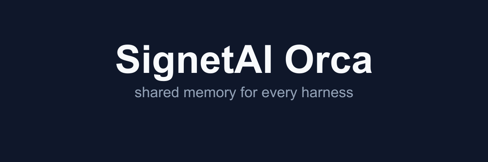
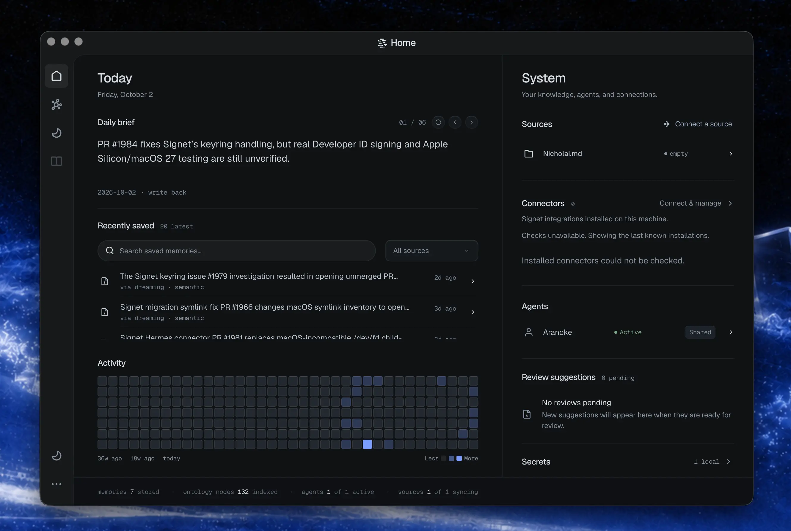

# SignetAI Orca: shared memory for every harness

> [!CAUTION]
> **Scam warning: Signet has no token or coin.** Any token or coin using the Signet name has nothing to do with this project. Do not buy it thinking it supports Signet.

> TechTide delivery fork of Signet. One memory graph across Claude Code, OpenCode, OpenClaw, Codex, Kimi, Hermes, Pi, and Gemini CLI. Local first with an audit trail back to source.

<p align="center">
  <picture>
    <source media="(prefers-color-scheme: dark)" srcset="docs/assets/orca-banner-dark.png" />
    <source media="(prefers-color-scheme: light)" srcset="docs/assets/orca-banner-light.png" />
    
  </picture>
</p>

<p align="center">
  <a href="https://github.com/Alexi5000/signetai_Orca/releases"></a>
  <a href="https://www.npmjs.com/package/signetai"></a>
  <a href="LICENSE"></a>
  <a href="https://docs.signetai.sh/benchmarking/"></a>
</p>

<p align="center">
  <a href="#quick-start-about-5-minutes">Quick start</a> ·
  <a href="docs/ORCA-HERO-STORY.md">Hero story</a> ·
  <a href="#harness-support">Harnesses</a> ·
  <a href="#documentation">Docs</a> ·
  <a href="https://docs.signetai.sh">Upstream docs</a>
</p>

Built by [Alex Cinovoj](https://alexcinovoj.com), Founder & CTO of [TechTide AI](https://techtideai.io) ([X](https://x.com/AlexCinovoj) · [LinkedIn](https://www.linkedin.com/in/alexcinovoj)). Read the delivery story in [docs/ORCA-HERO-STORY.md](docs/ORCA-HERO-STORY.md).

Upstream core by Signet AI: [Signet-AI/signetai](https://github.com/Signet-AI/signetai). Product docs at [signetai.sh](https://signetai.sh).

## Why this fork exists

**What it does.** Orca is TechTide's delivery fork of Signet: a local-first memory daemon that ingests transcripts and imports, builds derived memory through a background process called dreaming, and serves recall to Claude Code, OpenCode, OpenClaw, Codex, Kimi, Hermes, Pi, and Gemini CLI through hooks, plugins, and MCP. The fork keeps the upstream core and adds Orca positioning, delivery docs and assets, a README lint gate, and a run of security hardening fixes.

**Who it serves.** Operator teams that run more than one AI coding harness and want a single inspectable memory graph in their own environment, and the TechTide delivery engineers who install that system and hand it over to a client.

**Why Alex forked it.** The fork was created on 2026-03-11 (GitHub `created_at`) and previously tracked upstream until release 0.226.1 (`9229ff2ac`, 2026-09-13). The first fork-only commits on 2026-09-13 added a README quality harness (`af6971dd5`: "test: add readme quality lint harness"), upstream credit (`373ed9bc0`: "docs: add upstream credit and fork footer"), and the delivery narrative (`a212304a7`: "docs: add Orca hero story"). That narrative records the motivation: Alex Cinovoj, Founder & CTO of TechTide AI, "needed a local first memory layer with an audit trail, not another chat wrapper" for client delivery, and upstream Signet fit because transcripts and imports flow in, dreaming builds a living ontology, and every derived claim keeps a path back to its source ([docs/ORCA-HERO-STORY.md](docs/ORCA-HERO-STORY.md), section "Why Alex picked Signet"). Between 2026-10-17 and 2026-10-20 the fork added fourteen security fixes as PRs #1 to #14 (for example `b088556cf`: "fix: keep daemon responsive during database maintenance" and `f4940e315`: "fix: reject untrusted browser origins before daemon handlers").

**Real-world use case (2025–2026 evidence).** **Proposed use case.** A small operations team uses Claude Code for one workflow and Gemini CLI for another, and every new session starts without the context the other tool already learned. They install Orca once, run `signet setup`, and connect both harnesses: Claude Code through hooks and MCP, Gemini CLI through MCP plus GEMINI.md sync. Both tools then read and write the same local memory graph, and a reviewer can open `signet dashboard` to trace any recalled fact back to the transcript or import it came from. The pattern depends on stable extension points in the harnesses: the Model Context Protocol revision of 2025-11-25 defines the tools and resources interface the daemon serves[^1], Claude Code and Gemini CLI both shipped releases on 2026-10-20[^2][^3], and upstream Signet published v0.237.14 on 2026-10-18 with the harness integrations this fork carries[^4]. The hero story describes a client engagement in narrative form; this repository holds no deployment records, fixtures, or test output for that engagement, so the scenario is labelled proposed rather than verified.

[^1]: Model Context Protocol specification, revision 2025-11-25. https://modelcontextprotocol.io/specification/2025-11-25 (published 2025-11-25).
[^2]: Anthropic, Claude Code release v2.1.305. https://github.com/anthropics/claude-code/releases/tag/v2.1.305 (published 2026-10-20).
[^3]: Google, Gemini CLI release v0.65.0. https://github.com/google-gemini/gemini-cli/releases/tag/v0.65.0 (published 2026-10-20).
[^4]: Signet AI, signetai release v0.237.14. https://github.com/Signet-AI/signetai/releases/tag/v0.237.14 (published 2026-10-18).

## Trust

Local first. Your transcripts and imports stay in your workspace database. Dreaming builds derived memory with a path back to source, so recall stays inspectable and purgeable. No silent second writer. Telemetry is documented in docs/TELEMETRY.md. No paid tier trick in this README.

## Quick start (about 5 minutes)

### Install Signet

```bash
# macOS and Linux
curl -fsSL https://signetai.sh/install.sh | bash

# npm or Bun (Windows, macOS, Linux)
npm install -g signetai
bun add -g signetai
```

On Windows x64, run this in PowerShell, then open a new window to get the updated `PATH`:

```powershell
iwr -useb https://signetai.sh/install.ps1 | iex
```

Then set up a workspace:

```bash
signet setup       # prepare a workspace and open guided onboarding
signet status      # confirm the daemon and Dreaming are healthy
signet dashboard   # browse memory, sources, and settings
```

The guided onboarding walks you through choosing a provider and connecting your sources and agents. If you're on a headless machine, or if you'd rather have an agent set it up, you can also run setup non-interactively by pasting this to your agent:

```
Install and fully configure Signet AI by following this guide exactly: https://signetai.sh/skill.md
```

Supported platforms: Linux x64/arm64, macOS x64/arm64, Windows x64, and Docker. See the [installation guide](https://docs.signetai.sh/getting-started/install/) for details and the [upgrade guide](https://docs.signetai.sh/upgrading/) for existing installs.

> The `stable` channel is what we recommend for everyday use. `nightly` builds (`install.sh | bash -s -- --nightly`) have unreleased work and can break.

### Setup

```bash
signet setup                         # interactive setup wizard
signet status                        # confirm daemon + pipeline health
signet dashboard                     # open memory + retrieval inspector
```

## Harness support

Signet runs underneath the tools you already use. Run `signet setup` to configure plugins and connectors. Currently, Signet supports:

|Harness|Integration path|
|---|---|
|[Claude Code](https://docs.anthropic.com/en/docs/claude-code)|Hooks + MCP|
|[OpenCode](https://github.com/sst/opencode)|Plugin|
|[OpenClaw](https://github.com/openclaw/openclaw)|Plugin|
|[Codex](https://github.com/openai/codex)|Native plugin + hooks/MCP fallback|
|[Kimi Code](https://github.com/MoonshotAI/kimi-cli)|Hooks + MCP / ACPX|
|[Hermes Agent](https://github.com/NousResearch/hermes-agent)|Memory provider plugin|
|[Pi](https://github.com/earendil-works/pi/tree/main/packages/coding-agent)|Extension|
|Oh My Pi|Extension|
|[Gemini CLI](https://github.com/google-gemini/gemini-cli)|MCP + GEMINI.md sync|
|[ForgeCode](https://forgecode.dev/)|Hooks + MCP|

> Don't see your favorite harness? File an [issue](https://github.com/Signet-AI/signetai/issues) and request that it be added!

<a href="https://signetai.sh/"></a>

Signet supports a wide variety of sources that can be imported directly into your agent's memory graph - included in dreaming sessions and surfaced as new connections in recall.

## How it works

<a href="https://signetai.sh/"></a>

Your **sources** bring the context you already have into Signet. Connected sources stay in sync as they change, and you can also import files and webpages as one-time imports (see [supported sources and formats](#supported-sources-and-formats)). Agent conversations are imported with who said what, when, and where it came from; interrupted imports resume, re-imports don't duplicate evidence, and you can export conversations back out as structured JSONL.

**Dreaming** maintains what Signet knows as your work evolves. It reads new evidence alongside your existing context, connects the people, projects, facts, and relationships it describes, revisits contradictions, and proposes updates to claims. Changes are validated and recorded with citations, and the original evidence is never rewritten. Time-sensitive claims, like a deadline or someone's current role, can have a review date so they get revisited before they go stale. You can watch Dreaming work in the dashboard through live traces and an operation ledger.

Read more: [Sources](https://docs.signetai.sh/sources/) · [Data portability](https://docs.signetai.sh/cli/data-portability/) · [Dreaming](https://docs.signetai.sh/pipeline/extraction-decisions/) · [Knowledge graph](https://docs.signetai.sh/knowledge-graph/) · [Architecture](https://docs.signetai.sh/architecture/)

### Supported sources and formats

|Source|Notes|
|---|---|
|Obsidian|Real-time file watcher. Connect multiple vaults read-only; supports the LLM-Wiki format.|
|GitHub|Real-time ingest of issues, pull requests, and discussions.|
|Notion|Syncs the pages and database entries shared with a Notion integration; re-syncs fetch only what changed.|
|Discord|Real-time crawler that contributes to memory and links into the existing knowledge graph.|
|Webpages|One-time import of a public URL, extracted to readable Markdown with page metadata.|
|Slack, email, Telegram, WhatsApp|_Coming soon_|

|Format|Extensions|
|---|---|
|Word|`.doc`, `.docx`, `.docm`|
|PowerPoint|`.ppt`, `.pps`, `.pot`, `.pptx`, `.pptm`, `.ppsx`, `.ppsm`|
|Excel|`.xls`, `.xlsx`, `.xlsm`, `.xlsb`|
|OpenDocument|`.odt`, `.ods`, `.odp`|
|Rich Text Format|`.rtf`|
|EPUB|`.epub`|
|CSV|`.csv`|
|PDF|`.pdf`|

## How Orca fits together

- Daemon owns core behavior and durable transitions in `platform/daemon`. CLI, dashboard, desktop, SDK, and harness integrations are clients.
- `surfaces/cli` is the source of truth (`signet setup`, `signet status`, `signet dashboard`).
- `surfaces/dashboard` shows memory plus retrieval plus audit trail.
- `surfaces/desktop` plus `surfaces/tray` give always on presence.
- `surfaces/browser-extension` captures web context.
- `integrations/` covers claude-code, codex, forge, gemini, hermes-agent, kimi, oh-my-pi, openclaw, opencode, pi, and unreal.

## Documentation

| Goal | Start here |
| --- | --- |
| Install in 5 minutes | [Quickstart](https://docs.signetai.sh/quickstart/) |
| Run the CLI | [CLI Reference](https://docs.signetai.sh/cli/) |
| Configure identity and workspace | [Configuration](https://docs.signetai.sh/configuration/) |
| Connect a harness | [Harnesses](https://docs.signetai.sh/harnesses/) |
| Guard secrets | [Secrets](https://docs.signetai.sh/secrets/) |
| See memory model | [Knowledge Architecture](https://docs.signetai.sh/knowledge-architecture/) |
| Check recall quality | [Benchmarks](https://docs.signetai.sh/benchmarking/) |
| Read the delivery story | [docs/ORCA-HERO-STORY.md](docs/ORCA-HERO-STORY.md) |

## Harnesses

A "harness" is the app or environment your agent runs in. Signet connects through each harness's own hooks, plugins, or extensions to supply memory in the background and capture new context as you work, so if you switch agents you don't have to start over.

|Harness|Integration|
|---|---|
|[Claude Code](https://docs.anthropic.com/en/docs/claude-code)|Hooks + MCP|
|[Codex](https://github.com/openai/codex) and ChatGPT desktop|Native plugin, hooks/MCP fallback|
|[OpenCode](https://github.com/sst/opencode)|Plugin|
|[OpenClaw](https://github.com/openclaw/openclaw)|Plugin|
|[Hermes Agent](https://github.com/NousResearch/hermes-agent)|Memory provider plugin|
|[Kimi Code](https://github.com/MoonshotAI/kimi-cli)|Hooks + MCP, ACPX inference|
|[Pi](https://github.com/mariozechner/pi-coding-agent)|Extension|
|Oh My Pi|Extension|
|[Gemini CLI](https://github.com/google-gemini/gemini-cli)|MCP + GEMINI.md sync|
|[ForgeCode](https://forgecode.dev/)|Hooks + MCP|
|[Muse Code](https://dev.meta.ai/docs/muse-code)|Hooks + MCP|

Agents can also message each other through Signet. Messages survive restarts and arrive at the start of the recipient's next session or prompt.

Don't see your harness? [Open an issue](https://github.com/Signet-AI/signetai/issues). See the [harness guides](https://docs.signetai.sh/harnesses/) for setup.

## Dashboard and desktop



The dashboard is where you look through your memory, connect sources and agents, change settings, and watch Signet work. It includes a memory graph of the people, projects, and claims Signet knows about, and a chat for asking questions of your memory with any connected model. Answers cite the memories they draw on.

It runs in your browser via `signet dashboard`, or as a desktop app on macOS, Linux, and Windows x64:

```bash
signet desktop install
```

## Inspecting and trusting memory

- **Provenance:** when you recall a memory, Signet shows where it came from, how it's changed, and whether it's been reviewed.
- **Claim traces:** you can ask why Signet believes something and get its history, competing claims, and the exact source passages, from the CLI, API, or MCP.
- **Agent isolation:** each agent only sees the memory it's allowed to read.
- **Secrets:** secrets are stored encrypted, with the master key in your OS keyring. Systems without a keyring fall back to encrypted file storage and show a health warning. Make sure to keep your keychain in your recovery plan; see [Secrets](https://docs.signetai.sh/secrets/).
- **Recovery:** protection status shows whether a backup has been verified as restorable and flags backups that are missing or stale.
- **Hostile content:** content that matches known hostile patterns is kept out of what your agents see.

## Telemetry

Signet sends anonymous usage data: install and version counts, feature usage, token and cost totals per provider, and sanitized crash reports. It never sends memory content, prompts, search queries, or anything that identifies you. Every event is also written to a local log in your workspace so you can read exactly what was sent.

To turn it off, set `telemetryEnabled: false` in your config or `SIGNET_TELEMETRY_OPTOUT=1` in your environment. See [telemetry controls](https://docs.signetai.sh/analytics/).

## Benchmarks

Signet's latest tracked MemoryBench run averages **97.6% LongMemEval answer accuracy**. Keeping your memory local shouldn't mean you have to settle for weak recall. See [Benchmarks](https://docs.signetai.sh/benchmarking/#current-longmemeval-score) for the methodology, scoring note, and run workflow.

## Documentation

[Quickstart](https://docs.signetai.sh/quickstart/) · [CLI](https://docs.signetai.sh/cli/) · [Configuration](https://docs.signetai.sh/configuration/) · [Dashboard](https://docs.signetai.sh/dashboard/) · [Harnesses](https://docs.signetai.sh/harnesses/) · [Hooks](https://docs.signetai.sh/hooks/) · [Skills](https://docs.signetai.sh/skills/) · [Secrets](https://docs.signetai.sh/secrets/) · [Auth](https://docs.signetai.sh/auth/) · [SDK](https://docs.signetai.sh/sdk/) · [API](https://docs.signetai.sh/api/) · [Telemetry](https://docs.signetai.sh/analytics/) · [Workspace v2](https://docs.signetai.sh/workspace-v2/) · [Roadmap](ROADMAP.md) · [Repository map](repo.map.yaml)

## Development

```bash
git clone https://github.com/Signet-AI/signetai.git
cd signetai

bun install
bun run build
bun test
bun run lint
```

```bash
cd platform/daemon && bun run dev     # Daemon dev (watch mode)
cd surfaces/dashboard && bun run dev  # Dashboard dev
```

To develop this repository, you'll need:

- Bun for normal repo development
- Node.js 18+ for Node-targeted package surfaces
- Bun on the process `PATH` for local secrets access from macOS Node runtimes; compiled Signet and the desktop app include their helper runtime
- macOS or Linux
- Optional for harness integrations: any of the harnesses listed above

## Contributing

If you're new to open source, start with [Your First PR](https://docs.signetai.sh/first-pr/). For code conventions and project structure, see [CONTRIBUTING.md](CONTRIBUTING.md). Open an issue before contributing significant features, and read the [AI Policy](AI_POLICY.md) before submitting AI-assisted work.

## Contributors

Made with love by...

<a href="https://github.com/NicholaiVogel"></a> <a href="https://github.com/aaf2tbz"></a> <a href="https://github.com/Ostico"></a> <a href="https://github.com/BusyBee3333"></a> <a href="https://github.com/stephenwoska2-cpu"></a> <a href="https://github.com/PatchyToes"></a> <a href="https://github.com/ddasgupta4"></a> <a href="https://github.com/LeuciRemi"></a> <a href="https://github.com/nyashkn"></a> <a href="https://github.com/Alexi5000"></a> <a href="https://github.com/dragontvstaff"></a> <a href="https://github.com/maximhar"></a> <a href="https://github.com/alcar2364"></a> <a href="https://github.com/noamsiegel"></a> <a href="https://github.com/lost-orchard"></a> <a href="https://github.com/gpzack"></a> <a href="https://github.com/Jarvis-ORC-HPS"></a> <a href="https://github.com/nanookclaw"></a> <a href="https://github.com/quannon"></a> <a href="https://github.com/arnavgoel17"></a> <a href="https://github.com/glen-tl"></a> <a href="https://github.com/mikemikimike"></a>
<br clear="left" />

## Links

[Hero story](docs/ORCA-HERO-STORY.md) · [Upstream](https://github.com/Signet-AI/signetai) · [Docs](https://docs.signetai.sh) · [Changelog](./CHANGELOG.md) · [Security](./SECURITY.md)

Built by [Alex Cinovoj](https://alexcinovoj.com) for [TechTide AI](https://techtideai.io).

## Upstream

Upstream is [Signet-AI/signetai](https://github.com/Signet-AI/signetai) by Signet AI, licensed Apache-2.0. LICENSE, NOTICE, and THIRD_PARTY_LICENSES.md are preserved unchanged and this fork does not relicense. Product docs live at [signetai.sh](https://signetai.sh) and [docs.signetai.sh](https://docs.signetai.sh). This fork is [Alexi5000/signetai_Orca](https://github.com/Alexi5000/signetai_Orca), created 2026-03-11 and maintained by Alex Cinovoj, Founder & CTO of TechTide AI, for client delivery. Core memory behavior stays with upstream.

**What changed in this fork.** `git log upstream/main..origin/main` on 2026-10-21 lists 35 fork-only commits:

- Orca positioning, 21 commits on 2026-09-13 and 2026-09-14: README hero and structure, banner and social assets under `docs/assets/`, `docs/ORCA-HERO-STORY.md`, and the README lint gate (`.github/workflows/readme-lint.yml`, `scripts/checks/`).
- Security hardening, PRs #1 to #14 merged 2026-10-17 to 2026-10-20: daemon lock handling, release version validation, private boot diagnostics, atomic runtime file publishing, regex backtracking bounds, prototype-key rejection in config merge, HTML escaping in mockups, GraphQL variables for project sync, protected daemon log descriptors, browser origin checks, and text-only HTML import parsing.
- Fork release automation is opt-in; see "Fork release automation" below.

**Upstream synchronized.** This integration includes all upstream commits through `a160ee19208fb5c66d7bc2d39c7d1ba7fd4470ec` (v0.237.17), with fork delivery assets and applicable security hardening retained.

## License

Apache-2.0.

---

[signetai.sh](https://signetai.sh) ·
[docs](https://docs.signetai.sh) ·
[upstream](https://github.com/Signet-AI/signetai) ·
[orca fork](https://github.com/Alexi5000/signetai_Orca) ·
[issues](https://github.com/Signet-AI/signetai/issues)

### Fork release automation

Nightly publishing is opt-in on this fork. Set the repository variable `RELEASES_ENABLED=true` only after configuring `RELEASE_PAT` and the publishing credentials required by `.github/workflows/release.yml`. Quality checks remain enabled independently.

The HTTP-side compatibility accessor uses a zero SQLite busy timeout: lock contention fails explicitly and existing worker retry loops can retry after owner maintenance. Diagnostics, embedding candidate reads, and usage accounting run through the database owner. This does not complete the repository-wide migration of all legacy callbacks.

The link check excludes the three exact X, LinkedIn, and npm website URLs that reject unauthenticated CI crawlers. The npm package is checked separately through its registry; social profile ownership still requires a browser review.

## Upstream synchronization

This integration incorporates upstream v0.237.17 while preserving Orca branding, delivery assets, README checks, and fork security fixes. Upstream retired the external MCP marketplace and derived memory-content-safety table; their obsolete route patches are superseded by those removals. Existing source evidence remains intact. Atomic private writes, scoped filesystem access, request-origin checks, and database owner boundaries remain enforced.
